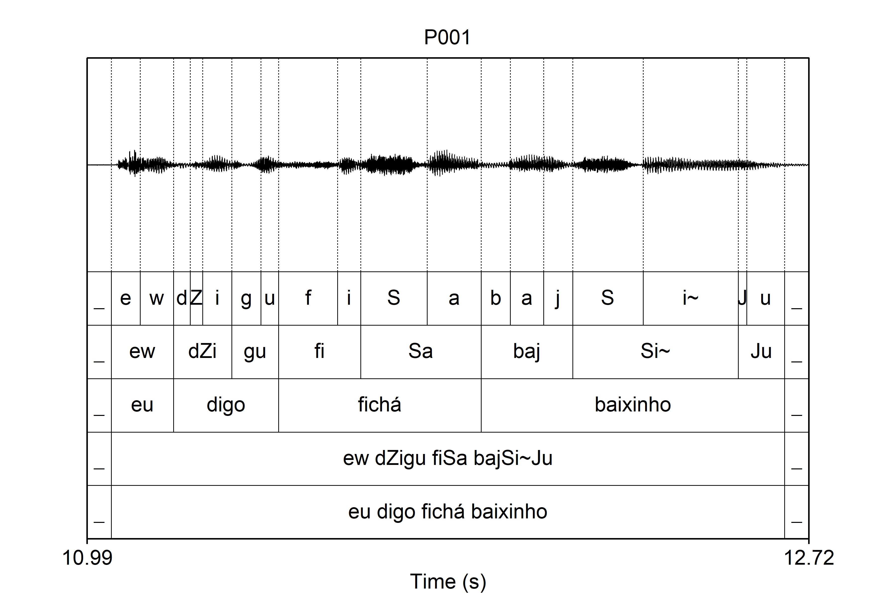

### 📋 Estrutura Esperada dos TextGrids

Para que o script funcione perfeitamente com as configurações padrão, os seus arquivos `.TextGrid` devem ter a marcação hierárquica dividida em camadas (*tiers*). 

O script foi desenhado originalmente para ler a seguinte estrutura:
*   **Tier 1 (Segmentos):** Fones individuais (ex: `e`, `d`, `g`, `v`, `a`, `s`)
*   **Tier 2 (Sílabas):** Divisão silábica (ex: `e`, `dZg`, `va`, `gas`)
*   **Tier 3 (Palavras):** Palavra alvo (ex: `vagas`)
*   **Tier 5 (Ortografia):** A frase inteira (ex: `eu digo vagas baixinho`)

Abaixo está o modelo de TextGrid previsto para o script, gerado via EasyAlign (plugin de segmentação automática para o Praat).



**Meus TextGrids são diferentes. O script funciona?**
Sim! A estrutura acima é apenas o padrão. Se os seus dados estiverem em tiers diferentes (por exemplo, palavras no Tier 2 e fones no Tier 3), basta abrir o script Python e alterar os números na seção de configurações:

```python
ORTHO_TIER = 5
WORD_TIER = 3
SYLL_TIER = 2
SEG_TIER = 1
